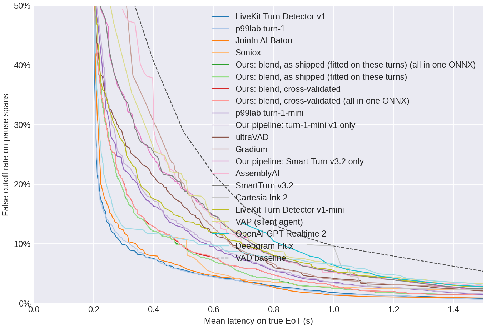

# Benchmarks

Two things are measured here: how well turn-blend decides that a turn is over (LiveKit's eot-bench), and
how much compute and delay it costs (latency).

## 1. End-of-turn accuracy: eot-bench

Benchmark: [LiveKit eot-bench](https://github.com/livekit/eot-bench), English, 400 real user turns
(`livekit/eot-bench-data`, revision `ca9d98a`, harness commit `0b5098f`). Run on 12 November 2026.

The harness asks the model, every 0.1 s inside each labelled pause, for its probability that the turn is
over. It then sweeps threshold, minimum silence and timeout itself and reports the best trade-offs:
the false cut-off rate reachable within a latency budget, and the mean latency reachable within a
cut-off budget. 400 turns, 1,250 pauses, 11,191 decision points.

| Model | False cut-offs @ 300 ms | False cut-offs @ 600 ms | Latency @ 5% cut-offs | Latency @ 10% cut-offs |
|---|---:|---:|---:|---:|
| LiveKit Turn Detector v1 (hosted) | 9.9% | 4.5% | 543 ms | 295 ms |
| p99lab turn-1 (20 GB GPU) | 10.6% | 4.5% | 553 ms | 321 ms |
| JoinIn AI Baton (hosted) | 12.3% | 4.8% | 577 ms | 350 ms |
| Deepgram Flux (hosted) | 12.9% | 9.9% | 1151 ms | 548 ms |
| **turn-blend.onnx, cross-validated** | **20.1%** | **7.8%** | **798 ms** | **487 ms** |
| turn-blend.onnx, as shipped (fitted on these turns) | 19.1% | 7.1% | 722 ms | 495 ms |
| p99lab turn-1-mini | 22.6% | 9.6% | 849 ms | 580 ms |
| ultraVAD (8B LLM) | 27.7% | 11.9% | 899 ms | 663 ms |
| LiveKit Turn Detector v1-mini | 27.8% | 12.1% | 1070 ms | 698 ms |
| Smart Turn v3.2 | 35.2% | 14.8% | 1051 ms | 739 ms |
| VAD baseline (silence only) | 55.6% | 21.7% | 1600 ms | 1000 ms |

Lower is better everywhere. Rows other than turn-blend are the results committed in the eot-bench
repository; they were not re-run here. AUC of the cross-validated blend is 0.985 (Smart Turn alone 0.845,
turn-1-mini alone 0.970).

The harness's own comparison report, with every published entry and the charts, is in
[eot-bench/report.md](eot-bench/report.md). In that report the rows named "Ours: ... (all in one ONNX)" are
`turn-blend.onnx`; the other "Ours" rows are the multi-model pipeline the file was built from.

### What the blend adds over its parts

Against Smart Turn v3.2 alone the gain is large (35.2% to 20.1% false cut-offs at 300 ms). Against
turn-1-mini alone it is modest: about 2.5 points at 300 ms, 1.8 points at 600 ms, 51 ms at the 5% budget
and 93 ms at the 10% budget. Most of the blend's strength comes from turn-1-mini; Smart Turn and the
silence term add a smaller improvement on top.

### Which number to trust, and the limits

- **Cross-validated is the headline.** The blend's four weights were refitted five times, each time on 320
  turns, and each turn was scored with weights that never saw it.
- **As shipped is optimistic.** The weights inside `turn-blend.onnx` were fitted on all 400 of these turns,
  so that row is scored on its own training data.
- **One dataset.** The blend was designed, fitted and tuned on this dataset. Cross-validation guards against
  fitting individual turns, not against fitting this dataset's speakers, microphones and task style. Expect
  a smaller gain on other audio.
- **Scored on every chunk.** The benchmark run scored Smart Turn on every 32 ms chunk
  (`score_every_chunks=1`). The shipped default is every second chunk, so that a CPU keeps up in real time;
  that can delay a decision by up to 32 ms compared with the benchmark.
- **The harness picks the policy.** As for every row, threshold, minimum silence and timeout are chosen by
  the harness on the same turns it scores. The shipped commit rule (blend above 0.85 twice in a row after
  320 ms of silence) is not what the benchmark measures.
- **Local run.** Nothing was submitted to the public leaderboard.
- **English at 16 kHz only.** Telephony audio and other languages are untested.

### Files

| Path | What it is |
|---|---|
| `eot-bench/report.md`, `eot-bench/*.png` | The harness's comparison report and charts |
| `eot-bench/runs/*/summary.json` | Metrics of each of our runs (operating points, AUC) |
| `eot-bench/runs/*/manifest.json` | What was run: dataset revision, span set, row counts |
| `eot-bench/blend_cv.json` | Fold assignment and the blend weights fitted in each fold |

## 2. Latency

Measured on an AMD Ryzen 5 5600H laptop (6 cores, 12 threads), CPU only, onnxruntime 1.32.0, on 90 s of
four-person meeting speech, with the default settings.

### Compute per 32 ms chunk

`python benchmark/latency.py recording.wav` ([latency.json](latency.json))

| Threads | Most chunks (p50) | Chunks that run Smart Turn (p50 / p99) | All chunks (mean / p99) | Speed |
|---:|---:|---:|---:|---:|
| 1 | 3.3 ms | 81.4 / 87.1 ms | 13.2 / 83.4 ms | 2.4x real time |
| 2 | 2.8 ms | 46.1 / 49.6 ms | 8.4 / 47.3 ms | 3.8x real time |
| 4 | 2.9 ms | 31.4 / 35.5 ms | 6.6 / 33.5 ms | 4.8x real time |
| 6 | 3.0 ms | 27.4 / 30.8 ms | 6.2 / 28.8 ms | 5.2x real time |

Most chunks run only Silero VAD and turn-1-mini. While a turn is open, every second chunk also runs
Smart Turn on up to 8 s of audio, which is the expensive part. A chunk is 32 ms of audio and Smart Turn runs
on every second one, so its budget is 64 ms: 2 or more threads keep up, 1 thread does not during a turn.

### Delay added inside Pipecat

`python benchmark/analyzer_lag.py recording.wav` ([analyzer_lag.json](analyzer_lag.json))

Audio was fed to `TurnBlendAnalyzer` as 20 ms frames at real-time pace, with 4 threads. Over 13 turns, all
ended by the blend:

| | Mean |
|---|---:|
| Silence the model waited for before ending the turn | 719 ms |
| Last speech to the turn being reported (`detect_ms`) | 751 ms |
| Delay added by queueing and compute | 32 ms (max 37 ms) |

The 719 ms is on meeting speech with the shipped commit rule and is not comparable with the eot-bench
latency figures, which use the harness's own policy on a different dataset.

### Not measured

A GPU or TensorRT run of this file, other CPUs, and the full voice-to-voice latency of a bot (that depends
on the STT, LLM and TTS services; the example bot logs it per turn).
